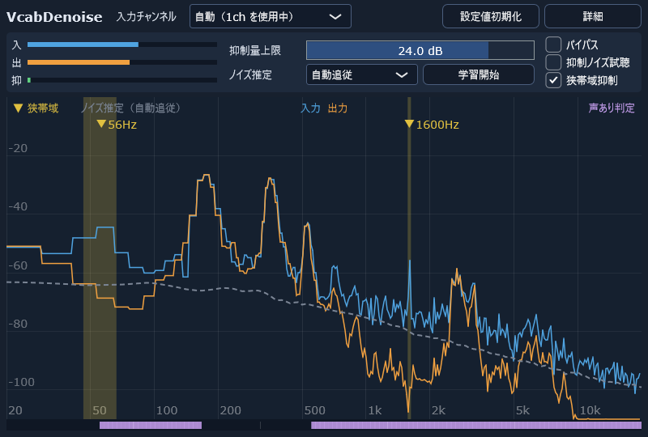

# VcabDenoise



声のためのノイズ除去（デノイズ）プラグインです。遅延 0 で、配信やボイスチャットのマイクの声から、PC のファンのような定常的なノイズと、「ふぃーん」「キーン」のような狭帯域の持続音を下げます。

自作のボイスチェンジャー [VoiChanAlgoBox](https://github.com/xelloss120/VoiChanAlgoBox) のデノイズの部品を土台に、デノイズだけを使いやすくまとめたものです。

| 項目 | 内容 |
|---|---|
| 形式 | VST3 プラグインと、単体で動く EXE 版 |
| 対応 | Windows（64bit） |
| 遅延 | 0（分析は FFT、音には最小位相の FIR フィルタをかける。音そのものは FFT に通さない） |
| 負荷 | CPU 1 コアの約 7%（48kHz） |

## できること

| 機能 | 内容 |
|---|---|
| 抑制（広い帯域） | log-MMSE（Ephraim・Malah）で、周波数の区画ごとに下げる量を決める。低い音（500Hz より下）は細かい分析、高い音は速い分析と分けて受け持つ |
| ノイズ推定 | 「自動追従」は、AI（RNNoise）の声の判定が「声なし」の間だけノイズを追いかける（話し続けても声を削りにくい）。「学習固定」は、ボタンを押してから、もう一度押すまでのノイズを覚えて使う（設定と一緒に保存できる） |
| 狭帯域抑制 | 周りより突き出た持続音を見つけて、その周波数だけを細く下げる。周波数が動いても追いかけ、段階的に飛ぶ音（コイル鳴きなど）にもすぐ付いていく |
| 立ち上がり保護 | 急に大きくなった帯域をすぐ開けて、話し始めの子音が削れるのを防ぐ |
| 抑制ノイズ試聴 | 抑制した音だけを聞く（声が混ざって聞こえたら、抑制しすぎ） |
| モニター | 入力と出力のスペクトル、ノイズ推定の線、抑制している狭帯域ノイズ（▼ と周波数）、声あり判定の帯 |

ふだんの画面には、主な操作（抑制量上限、ノイズ推定、バイパス、抑制ノイズ試聴、狭帯域抑制）だけを出します。細かい設定は「詳細」ボタンで開きます。どの項目も、マウスを乗せると説明が出ます。

## 使うときの注意

**ヘッドフォンで使ってください。** スピーカーで鳴らすと、出た音をマイクが拾って、ハウリング（キーンという大きな音）が起きることがあります。EXE 版は、起動してすぐ音が出るように、入力のミュートを初めからオフにしています。

EXE 版の初回は、「オーディオ設定」ボタン（左上の「オプション」の中と同じ画面）から、入力と出力のデバイスを選んでください。マイクの入力チャンネル（1ch / 2ch）は、初期値の「自動」で、音が来ているほうを選びます。

## EXE 版を初めて起動するとき

署名をしていないので、ダウンロードした EXE を初めて実行すると、Windows の「PC が保護されました」という青い画面が出ます。次のどちらかで実行できます。

- 「詳細情報」を押してから「実行」を押す
- 実行する前に、EXE（または ZIP）を右クリック → プロパティ → 下のほうの「許可する」にチェック → OK

一度実行すれば、同じファイルでは次から出ません。

## ビルド

必要なもの: Visual Studio 2022（C++ によるデスクトップ開発）、CMake 3.22 以上、Git

```
git clone https://github.com/xelloss120/VcabDenoise.git
cd VcabDenoise
git submodule update --init
cmake -S . -B build -G "Visual Studio 17 2022" -A x64
cmake --build build --config Release
```

- `C:\src` のような浅い場所に置いてください。深い場所だと、Windows のパスの長さの制限で、clone やサブモジュールの取得が失敗することがあります。
- サブモジュール（JUCE、RNNoise、pffft）は `git submodule update --init` で取得します。`--recursive` は要りません（pffft の中のサブモジュールは、性能比較用で使いません）。
- CMake は、Visual Studio に同梱のものも使えます（「Developer PowerShell for VS 2022」から実行すると、`cmake` コマンドが使えます）。

初回の `cmake -S ...` のときに、RNNoise の学習済みの重み（約 58MB）を公式の配布元（media.xiph.org）から取得します。インターネットにつながった状態で実行してください。

できるもの:

| ファイル | 内容 |
|---|---|
| `build/VcabDenoise_artefacts/Release/VST3/VcabDenoise.vst3` | VST3 プラグイン（フォルダ。フォルダごとコピーして使う） |
| `build/VcabDenoise_artefacts/Release/Standalone/VcabDenoise.exe` | EXE 版 |
| `build/vcabdn_render_artefacts/Release/vcabdn_render.exe` | 開発用の WAV 処理ツール |
| `build/vcabdn_shot_artefacts/Release/vcabdn_shot.exe` | 開発用の画面の撮影ツール（WAV を流しながら、プラグインの画面を PNG に書き出す。この README の画像もこれで作った） |

## 開発用の WAV 処理ツール（vcabdn_render）

WAV ファイルに、プラグインと同じ処理をかけて書き出します。

```
vcabdn_render --in noisy.wav --out out.wav --set max_reduction=18
vcabdn_render --in noisy.wav --out out.wav --set noise_mode=1 --learn 0:3
vcabdn_render --in noisy.wav --out out.wav --notches
vcabdn_render --list
```

`Tools/Regression` に、処理の音がビット単位で変わっていないかを確かめる回帰テストと、デノイズの効き方を測るツールがあります（使い方はそのフォルダの README）。

## ライセンス

Copyright (C) 2026 x120

[AGPLv3](LICENSE)（AGPL-3.0-only）。使っているライブラリ（JUCE、RNNoise、pffft など）のライセンスは [THIRD_PARTY_LICENSES.md](THIRD_PARTY_LICENSES.md) にまとめています。ASIO SDK を GPLv3 で使っているため、GPLv3 の本文を [LICENSES/GPL-3.0.txt](LICENSES/GPL-3.0.txt) に置いています。

VST is a trademark of Steinberg Media Technologies GmbH, registered in Europe and other countries.
